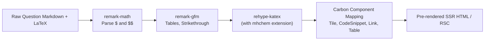

# OpenPapers Frontend V2: Design & Architecture Specification

## 1. Executive Summary & Goals

**OpenPapers** is an open-access platform designed for students and educators to browse, solve, and analyze past examination papers (specifically Sri Lankan Advanced Level examinations with plans for broader curricula).

This document defines the architectural and visual redesign of the OpenPapers frontend, marking a major transition:

- **Design System Transition**: Migrating from Ant Design (v5) to the **IBM Carbon Design System** (`@carbon/react`, `@carbon/styles`).
- **Brand Identity**: Embracing an **academic, structured, and sharp-edged** industrial design language, moving away from rounded consumer UI toward authoritative scientific publication styling.
- **Framework Modernization**: Leveraging **Next.js 15+ App Router** with full React Server Components (RSC) and Server-Side Rendering (SSR).
- **Enhanced Scientific Rendering**: Elevating Markdown and LaTeX rendering with server-side processing, chemistry equation support (`mhchem`), table formatting (`GFM`), and native Carbon component mapping.
- **Thematic Flexibility**: Establishing an open, tokenized color abstraction layer so branding palettes remain easily configurable without code rewrites.

---

## 2. Brand Identity & Visual Language

### 2.1 The Sharp-Edges Aesthetic

A key visual signature of this redesign is the **strict enforcement of sharp rectangular corners (0px border-radius)** across all interface surfaces:

- **Buttons**: Square-edged with standard Carbon 48px / 40px / 32px heights and distinct hover/active states.
- **Cards & Surfaces**: Carbon `Tile`, `ExpandableTile`, and `ClickableTile` with 0px corner radius, thin structured borders (`1px solid $border-subtle`), and subtle background elevation.
- **Inputs & Dropdowns**: Crisp rectangular form controls (`Dropdown`, `ComboBox`, `TextInput`).
- **Navigation & Modals**: Carbon `Header`, `SideNav`, and `Modal` with flat, unrounded geometry.

**Rationale**: Academic examination papers, mathematical treatises, and scientific journals are characterized by structured grids, crisp divider rules, and high information clarity. Carbon's native zero-radius geometry conveys rigor, precision, and focus.

### 2.2 Typography Hierarchy

The typography stack balances administrative UI clarity with scientific readability:

| Role                          | Font Family                          | Usage                                                         |
| :---------------------------- | :----------------------------------- | :------------------------------------------------------------ |
| **UI & Navigation**           | `IBM Plex Sans`                      | Headers, buttons, labels, navigation, metadata                |
| **Questions & Reading**       | `IBM Plex Serif` / `Computer Modern` | Question bodies, essay prompts, option text                   |
| **Mathematical Formulas**     | `KaTeX Fonts` (AMS, Math, Main)      | In-line equations ($\$x\$$), block equations ($\$\$... \$\$$) |
| **Code & Technical Notation** | `IBM Plex Mono`                      | Code blocks, unit symbols, question tags, IDs                 |

### 2.3 Layout Grid & Density

- Based on the **Carbon 16-Column 2x Grid** (8px baseline unit, 16px/32px gutter system).
- High visual density: exam navigation sidebar on the left, question reading pane on the right, providing clear visual anchoring without excessive whitespace padding.

---

## 3. Color System & Flexible Palette Architecture

Because the final brand color palette is still under review, the design system utilizes Carbon's semantic token abstraction layer combined with CSS Custom Properties.

### 3.1 Theme Architecture

Carbon natively provides four distinct contrast themes:

1. **`white`**: Crisp academic light theme with high contrast.
2. **`g10`**: Warm gray light theme (ideal for long reading sessions and reducing eye fatigue).
3. **`g90`**: Charcoal dark theme with muted contrast.
4. **`g100`**: True deep black/dark theme for night practice.

### 3.2 Token Abstraction Layer

Instead of hardcoding color hex codes into components, all OpenPapers components consume CSS custom properties aliased to Carbon tokens:

```scss
// src/styles/theme-tokens.scss
:root {
  // Brand Accent (Flexible - can be swapped easily)
  --op-brand-primary: var(--cds-interactive, #0f62fe);
  --op-brand-accent: var(--cds-link-primary, #0043ce);
  --op-brand-success: var(--cds-support-success, #24a148);
  --op-brand-error: var(--cds-support-error, #da1e28);
  --op-brand-warning: var(--cds-support-warning, #f1c21b);

  // Surface & Layout Tokens
  --op-surface-base: var(--cds-background);
  --op-surface-layer-1: var(--cds-layer-01);
  --op-surface-layer-2: var(--cds-layer-02);
  --op-border-subtle: var(--cds-border-subtle-01);
  --op-border-strong: var(--cds-border-strong-01);

  // Text Tokens
  --op-text-primary: var(--cds-text-primary);
  --op-text-secondary: var(--cds-text-secondary);
  --op-text-helper: var(--cds-text-helper);
}
```

**Benefits**:

- Palette changes require editing only the CSS root variable map or a single SCSS theme file.
- Automatic full support for Dark Mode switching via Carbon's `Theme` provider or `data-carbon-theme` HTML attribute.
- Compliant with WCAG 2.1 AA accessibility standards for color contrast out of the box.

---

## 4. Markdown & LaTeX Scientific Rendering Engine

### 4.1 Evaluation of Current Implementation

The legacy implementation used:

```tsx
<ReactMarkdown remarkPlugins={[remarkMath]} rehypePlugins={[rehypeKatex]}>
  {content}
</ReactMarkdown>
```

- **Issues in Legacy Setup**:
  1. Executed purely client-side inside a heavy `"use client"` component (`PaperClient.tsx`), re-parsing ASTs on every state change.
  2. Missing GitHub Flavored Markdown (`remark-gfm`): no tables, task lists, or strikethrough.
  3. Missing Chemistry formula support: Sri Lankan A-Level Chemistry requires formula notation ($\ce{H2SO4}$, $\ce{Fe^{2+}}$), which KaTeX supports via the `mhchem` extension.
  4. Raw HTML output unstyled: standard HTML paragraphs, headers, and code blocks did not match the design system.
  5. External font loading from a third-party CDN (`jsdelivr`) introduced latency and FOUT (Flash of Unstyled Text).

### 4.2 Modernized Markdown + LaTeX Stack



### 4.3 Proposed Renderer Improvements

1. **Server-Side Prerendering (RSC)**:
   - Render static question text and options on the server using Next.js Server Components.
   - Stream pre-compiled KaTeX HTML/MathML directly to the client, eliminating parsing lag and layout shifts.
2. **Chemical Equation Support (`mhchem`)**:
   - Integrate `katex/contrib/mhchem` so chemistry equations render accurately:

     ```markdown
     $\ce{2H2 + O2 -> 2H2O}$
     ```

3. **Carbon Component Mapping**:
   Map markdown tags directly to Carbon Design System components:
   - `code` $\rightarrow$ Carbon `CodeSnippet` (inline or block).
   - `a` $\rightarrow$ Carbon `Link`.
   - `table` $\rightarrow$ Carbon `DataTable` / structured table.
   - `blockquote` $\rightarrow$ Carbon styled quote callout.
   - `ul` / `ol` $\rightarrow$ Carbon `UnorderedList` / `OrderedList`.
4. **Self-Hosted KaTeX Assets**:
   - Bundle KaTeX WOFF2 fonts inside the repository or Next.js asset pipeline to ensure rapid offline/cached rendering without CDN roundtrips.

---

## 5. Carbon Design System Implementation Feasibility

### 5.1 Next.js 15+ App Router Compatibility

- **Client vs Server Boundaries**:
  Carbon React components rely on React contexts, DOM event listeners, and hooks. Therefore:
  - Interactive Carbon components (e.g. `Header`, `Dropdown`, `Button`, `Tile`, `RadioButtonGroup`, `Theme`) are treated as **Client Components** (`"use client"`).
  - Recommended pattern: Create a dedicated component library barrel (`@/components/carbon/index.ts`) re-exporting necessary Carbon components marked with `"use client"`.
  - Content containers, layout wrappers, and Markdown/LaTeX display nodes remain **React Server Components (RSC)** for optimal SSR performance.

### 5.2 Sass / SCSS Integration

Carbon requires Sass (`@carbon/styles`). Next.js 15 has built-in support for Sass.

- Install `sass`:

  ```bash
  npm install sass @carbon/react @carbon/icons-react
  ```

- Import Carbon styles in `src/app/globals.scss`:

  ```scss
  @use "@carbon/react";
  ```

- Modular Sass imports ensure tree-shaking and fast compile times with Turbopack.

### 5.3 Ant Design to Carbon Component Mapping

| Ant Design Component (Old) | Carbon Component (New)                       | Visual & UX Note                                         |
| :------------------------- | :------------------------------------------- | :------------------------------------------------------- |
| `Button`                   | `Button`                                     | Sharp 0px corners, high contrast primary/secondary/ghost |
| `Card`                     | `Tile` / `ExpandableTile`                    | Crisp bordered rectangular container                     |
| `Menu`                     | `SideNav` / `ContainedList`                  | Industrial question navigator                            |
| `Radio` / `Radio.Group`    | `RadioButtonGroup` / `TileGroup`             | Selectable option tiles with clear active outlines       |
| `Select` / `Form.Item`     | `Dropdown` / `ComboBox`                      | Clean rectangular select with inline search              |
| `Layout.Header`            | `Header`, `HeaderName`, `HeaderGlobalBar`    | Carbon Cloud/System navigation bar                       |
| `Steps`                    | `ProgressIndicator`, `ProgressStep`          | Linear step tracker for guide page                       |
| `Spin` / `Loading`         | `Loading` / `InlineLoading` / `SkeletonText` | Native Carbon loaders and skeleton placeholders          |

---

## 6. CBS MCP (Carbon Design System Model Context Protocol) Integration

### 6.1 Purpose & Feasibility

IBM provides the **Carbon Design System Model Context Protocol (CBS MCP)** server. This MCP enables AI pair-programming assistants to directly inspect:

- Official Carbon React component signatures and props.
- Carbon token definitions (spacing, color, typography, motion).
- Component design patterns and accessibility requirements (ARIA guidelines).
- Code examples and icon glyph sets.

### 6.2 Setup & Configuration in Workspace

The Carbon MCP server has been configured for the workspace in [`.agents/mcp_config.json`](file:///home/nithika/Uni/Academic%20Projects/OpenPapers/openpapers-frontend/.agents/mcp_config.json) (and synced to [`.vscode/mcp.json`](file:///home/nithika/Uni/Academic%20Projects/OpenPapers/openpapers-frontend/.vscode/mcp.json)):

```json
{
  "mcpServers": {
    "carbon-mcp": {
      "type": "streamable-http",
      "url": "https://mcp.carbondesignsystem.com/mcp",
      "oauth": true,
      "alwaysAllow": []
    }
  }
}
```

_Status_: Configured and ready in `.agents/mcp_config.json` for live context querying.

---

## 7. Migration Roadmap

```mermaid
flowchart TD
    Phase1[Phase 1: Environment & Carbon Baseline\n- SCSS setup\n- @carbon/react & icons install\n- Flexible theme tokens]
    Phase2[Phase 2: Scientific Renderer Upgrade\n- Server-side Markdown + KaTeX + mhchem\n- Carbon element mapping\n- Self-hosted fonts]
    Phase3[Phase 3: Core Shell & Navigation\n- Carbon Header & Footer\n- Theme Switcher (White / G10 / G90 / G100)\n- PaperSearchBox dropdowns]
    Phase4[Phase 4: Paper Practice View\n- Questions SideNav / ContainedList\n- Question Tile with sharp edges\n- Option selection & answer verification]
    Phase5[Phase 5: Ancillary Pages & Cleanup\n- Guide with ProgressIndicator\n- About Us with Team Tiles\n- Remove Ant Design dependencies]

    Phase1 --> Phase2 --> Phase3 --> Phase4 --> Phase5
```

---

## 8. Summary of Technical Decisions

1. **Git Branch**: Work is isolated on `feat/carbon-redesign`.
2. **Framework**: Retain **Next.js 15+ App Router** with SSR and Server Actions.
3. **Design System**: Adopt **IBM Carbon Design System** (`@carbon/react`) with **sharp edges (0px border-radius)** as the primary brand motif.
4. **Theming**: Implement flexible color tokens aliased to Carbon CSS variables, allowing immediate palette adjustments.
5. **Formulas & Content**: Upgrade Markdown + LaTeX engine to support SSR, `remark-gfm`, and `katex/contrib/mhchem`.
6. **Tooling**: Ready for IBM CBS MCP integration for accelerated, error-free component implementation.
